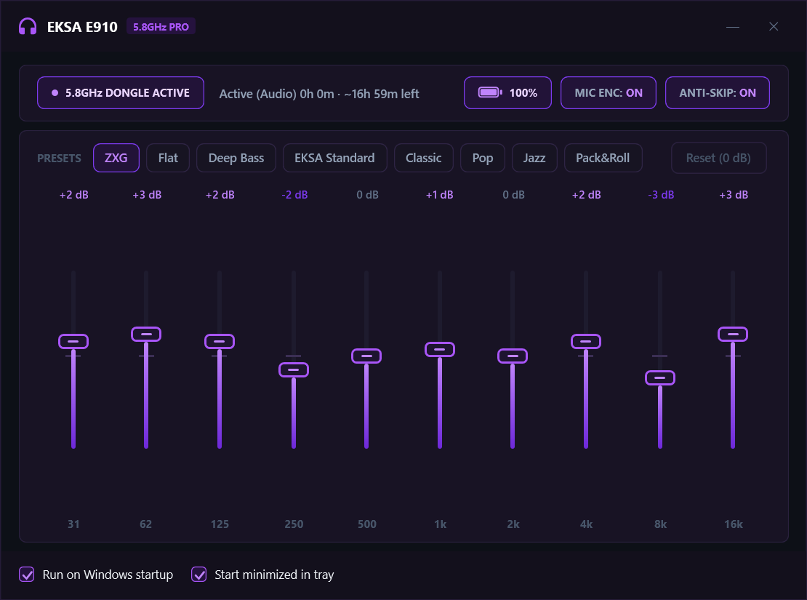

# EKSA E910 Equalizer & Control Software (`EksaTray` v1.3.0)

Modern, lightweight Windows 10/11 Equalizer, Anti-Skip Bass Gate, Mic ENC, and Battery Companion for the **EKSA E910 5.8GHz Wireless Gaming Headset** (`VID_3206&PID_0F06` / Hongkong Nano IC USB Audio Bridge) — a zero-bloat replacement for the legacy OEM `ToneTuningTool.exe` ("EKSA 7.1 Surround Sound" driver utility).



## Why Use This Instead of `ToneTuningTool.exe`?

- **Direct Hardware 10-Band Parametric EQ (`COL01` USB HID)**:
  - Writes 10-band hardware PEQ curves (`SetPEQ` `0x21` + `SetAlgorithmSwitch` `0x31`) directly to the EKSA 5.8GHz USB transmitter DSP.
  - Built-in presets (**ZXG**, **Flat**, **Deep Bass**, **EKSA Standard**, **Classic**, **Pop**, **Jazz**, **Pack&Roll**) + **Custom** per-band tuning (`-12 dB` to `+12 dB`).
- **Fixes Low-Frequency / Quiet Sound Skipping (`ANTI-SKIP: ON/OFF`)**:
  - The EKSA E910 hardware DAC has an aggressive zero-detect noise gate that causes quiet or low-frequency sounds (such as footsteps on grass in Minecraft) to cut out or skip at normal volume.
  - Our on-demand **14 Hz Anti-Skip Low-Frequency Gate** plays a `-54 dBFS` (`< 0.00015 mW`) sub-audible pilot wave while external audio is playing to hold the DAC gate open, and automatically shuts off after **15 seconds of silence** for **`0%` idle battery drain**.
- **Auto EQ Resync After 5-Hour Headset Power-Cycles**:
  - Automatically runs a 15ms hardware slot-unlatch cycle (`0x01 -> 0x06`) when audio wakes from idle and every 45 seconds during active playback, so turning the headset back on automatically restores your EQ without opening the app.
- **Hardware Mic ENC Toggle (`MIC ENC: ON/OFF`)**:
  - One-click hardware microphone Environmental Noise Cancellation toggle on the USB dongle DSP.
- **Smart Audio-Only Battery Counter (15s Idle Pause)**:
  - Tracks real per-session CoreAudio output peaks (ignoring silent background sessions and microphone room noise) and pauses automatically after **15 seconds of silence**.

## Download & Install

1. Download **`EksaCompanion-v1.3.0-x86.zip`** from the [**Latest Release**](https://github.com/lZXGl/EKSA-E910-Equalizer-Software/releases/latest).
2. Extract and run **`EksaTray.exe`**.

## Building from Source (`x86`)

`MyHidApi.dll` is a 32-bit native library, so the project targets `x86` on .NET Framework 4.8:

```powershell
& "C:\Windows\Microsoft.NET\Framework\v4.0.30319\MSBuild.exe" EksaCompanion.csproj /p:Configuration=Release /p:Platform=x86 /v:minimal
```

Output executable: `bin\x86\Release\EksaTray.exe`
